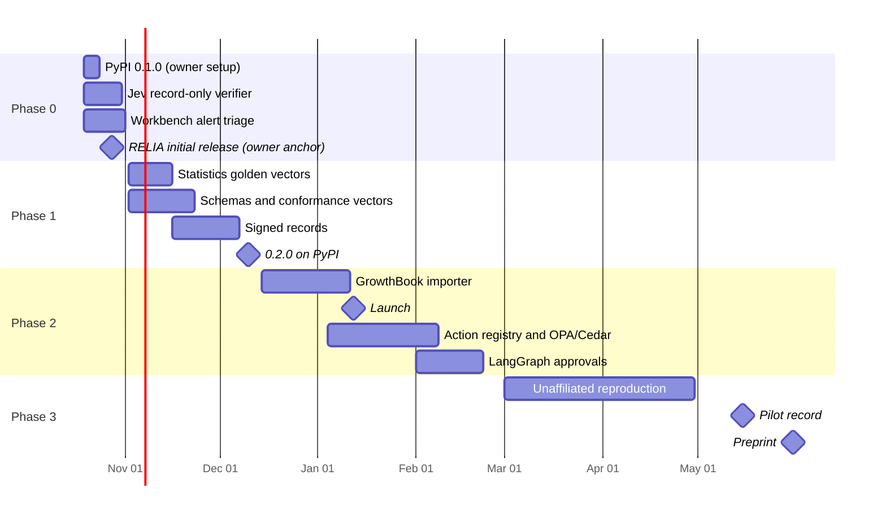

# ai-decision-system plan: re-verifiable records for AI go/no-go decisions

Status: 2026-10-19. Owner: Bicheng Wang. This directory is the source of truth for
direction and the delivery queue. Change
[`decisions.md`](decisions.md) first when direction changes. RELIA's own
[roadmap](../ai-workflows/ai-decision-reliability/docs/ROADMAP.md) stays
authoritative for RELIA's research and release milestones.

| File | Contents |
| --- | --- |
| [`decisions.md`](decisions.md) | Direction decisions (adopted and proposed), date, reason and what would reopen them |
| [`phase-0-ship-0.1.md`](phase-0-ship-0.1.md) | 2026-10-19 → 2026-11-01: packages on PyPI, every record verifiable, repository cleaned up |
| [`phase-1-records-spec.md`](phase-1-records-spec.md) | 2026-11-02 → 2026-12-13: schemas, conformance vectors, signed records, statistics cross-check, 0.2.0 |
| [`phase-2-bridges.md`](phase-2-bridges.md) | 2026-12-14 → 2027-02-28: importers for GrowthBook, OPA/Cedar and LangGraph; launch; first pilot |
| [`phase-3-external-evidence.md`](phase-3-external-evidence.md) | 2027-03-01 → 2027-05-31: unaffiliated reproduction, pilot record, regulatory mapping, preprint |

Plan IDs (`P-0NN`) are stable across phases. The [continual delivery task](../docs/CONTINUAL_DELIVERY.md)
turns `agent` rows of the active phase into `continual-ready` issues carrying the
Plan ID, and searches for that ID before creating anything.

## Identity

> A decision record carries the inputs and frozen rules needed for a third party
> to recompute an AI-assisted go/no-go decision offline, and says exactly what it
> does not prove. This repository defines those records and ships small,
> standard-library reference tools that produce and verify them at three
> decision points: a typed model answer, a policy-gated action with human
> approval, and an experiment promotion. RELIA is the human-gated reference for
> model release.

The identity is unchanged from the README. What changes is the emphasis: from
"three packages" to "a record format with reference verifiers", because the gap
is the record, not another platform.

- **Nobody else ships the replayable decision itself.** OPA decision logs carry
  input, result and bundle revision but are neither signed nor hash-chained, and
  fields can be masked ([OPA docs](https://www.openpolicyagent.org/docs/management-decision-logs)).
  MLflow approvals are mutable tags and aliases ([MLflow docs](https://mlflow.org/docs/latest/ml/model-registry/)).
  in-toto's verification summary predicate "does not include information for
  reproducing the verification result" ([SVR](https://github.com/in-toto/attestation/blob/main/spec/predicates/svr.md)).
  LangGraph approvals are checkpointed state, not evidence ([interrupts](https://docs.langchain.com/oss/python/langgraph/interrupts)).
- **Logging duties exist, formats don't.** EU AI Act Article 12 requires
  automatic event logs for high-risk systems without prescribing a format;
  Articles 19 and 26 require at least six months' retention. Regulation (EU)
  2026/1744 moved Annex III obligations to 2 December 2027 (secondary sources:
  [White & Case](https://www.whitecase.com/insight-alert/eu-ai-omnibus-enters-force-amending-ai-act),
  [lawgent](https://lawgent.se/ai-act-logging-record-keeping-article-12/); confirm
  on EUR-Lex before citing). ISO/IEC 42001 control A.6.2.8 asks for event logs at
  defined lifecycle phases. None of this makes our records compliance evidence;
  it makes "which inputs and which rules produced this decision" a question
  auditors will ask.
- **So we complement, not compete.** Signing and transport come from in-toto and
  Sigstore, policy from OPA or Cedar, statistics from the experiment platform,
  workflow from LangGraph. Our part is the record and its verifier.

## Where we start

| Fact (2026-10-18) | Value |
| --- | --- |
| Packages | `expgate`, `jevdecision`, `decisioncontrol` 0.1.0 tagged and GitHub-released 2026-10-13 (PR #224). 903 / 1,592 / 1,180 source lines; 76 / 105 / 98 tests pass locally (Python 3.15.0) |
| PyPI | All three names returned 404 on 2026-10-18 and the release workflow's `pypi` job was skipped; the READMEs say "PyPI pending". On 2026-10-19 GitHub environment `pypi` (required reviewer BichengWang, tag patterns `experiment-gate/v*`, `jev-decision/v*`, `decision-control/v*`) and `PYPI_PUBLISH=true` were set; the owner registers the three pending publishers, and nothing has been published yet |
| Verifiers | `experiment-gate-verify` and `decision-control replay` exit 1 on tampering in tests. Jev has no record-only verifier ([records table](../docs/DECISION_RECORDS.md#records-and-checks)), so P-009 holds for two of three packages |
| Canonical form | Digests use Python `json.dumps(sort_keys=True, separators=(",", ":"), ensure_ascii=False)`. Python writes `5.0` and `1e-07`; JavaScript and RFC 8785 write `5` and `1e-7`. Every bundled expgate example contains integral floats such as `20.0`, so a non-Python verifier cannot recompute `input_sha256` today. RFC 8785 was adopted on 2026-10-19 for the next schema version of each affected record type; P-011 and P-017 implement it |
| RELIA | Candidate 0.1.5, spec 0.1.3, 1,098 source lines, 38 tests; unreleased and human-gated. Its roadmap's September 2026 FTC comment (docket FTC-2026-1057, closed 2026-09-25) was filed as regulations.gov document FTC-2026-1057-0650 (received 2026-08-29, posted 2026-08-31) on the owner's confirmation; it does not contain the technical description the roadmap planned. Initial release anchor set by the owner: 2026-10-28 |
| Workspace | `make workspace-check` passes (6 components); CI green on `main` |
| Security | 100 open Dependabot alerts (2 critical, 48 high, 42 medium, 8 low): 99 in root `uv.lock`, 1 in `requirements.txt`, all from the legacy `src/` workbench (301 tracked files, 96 notebooks). CI does not exercise the merged airllm 4.0.0 and transformers 5.19.0 bumps |
| Delivery loop | Last `continual-managed` PRs #218–#220 merged 2026-10-12. P-006–P-010 landed in human PR #224. No issues exist for P-011 onward |
| Audience | 152 stars, 12 forks, 9 watchers. Contributors: the owner (743 commits) and Dependabot (38). 0 open issues. Views 2026-10-04 → 17: 360 (163 unique), peak 2026-10-14 at 94 (73 unique); top referrer Google (23 unique) |
| Signal quality | 57 of 152 stargazers have 0 followers and at most 2 public repositories; about 33 accounts were under 60 days old when they starred. The 12 forks have 0 stars each and were last pushed 2026-10-09 → 13. Stars are not adoption evidence here |

## What the README looks like at month six

A visitor sees one install line, one verify line, and a table of record types
whose schemas and vectors any language can use:

```markdown
pip install expgate jevdecision decisioncontrol

| Record | Schema | Verify offline | Vectors |
| --- | --- | --- | --- |
| Experiment promotion | `expgate/schema/decision.v<N>.json` | `experiment-gate-verify decision.json` | valid / tampered / invalid |
| Typed model answer | `jevdecision/schema/answer.v<N>.json` | `jev-decision-verify answer.json` | valid / tampered / invalid |
| Human-approved action | `decisioncontrol/schema/record.v<N>.json` | `decision-control replay --record record.json` | valid / tampered / invalid |

Signed records: in-toto Statement + DSSE; verify with the package or cosign.
Bridges: GrowthBook results → expgate; OPA/Cedar decisions → decision-control;
LangGraph interrupt approvals → decision-control.
Used by: (only entries the user agreed to publish)
```

## Target repository layout

Additions only; packages stay independent with standard-library runtimes.

```text
ai-decision-system/
├── .plan/                                   # this plan
├── ai-workflows/<project>/
│   ├── <package>/schema/<record>.v<N>.json  # P-011, shipped as package data
│   └── conformance/{valid,tampered,invalid}/ # P-011, canonical bytes + digest per vector
├── ai-workflows/experiment-gate/tests/golden/ # P-013, reference-library vectors
├── ai-workflows/experiment-gate/expgate/importers/ # P-025 GrowthBook
├── ai-workflows/decision-control/decisioncontrol/adapters/ # P-015 OPA, Cedar
└── src/, tests/, root uv.lock               # stay; alerts triaged by P-019
```

## Calendar



## Success measures

| By | Engineering | External evidence |
| --- | --- | --- |
| 2026-11-01 | `pip install expgate jevdecision decisioncontrol` works in a clean venv; every record type has a record-only verifier; no open critical or high Dependabot alerts | – |
| 2026-12-13 | 0.2.0 on PyPI with schemas, conformance vectors, golden-vector tests and optional signed records; a non-Python validator passes every vector in CI | – |
| 2027-02-28 | GrowthBook, OPA/Cedar and LangGraph bridges released | Launch done; first issue or PR from someone other than the owner; one pilot agreed in writing |
| 2027-05-31 | – | One unaffiliated reproduction recorded; one pilot record (any outcome) published with permission; preprint posted |

Monthly PyPI downloads (pypistats, without mirrors) and stars are reported in the
quarterly review and never used as targets. A request is not a review, a review
is not use, and interest is not adoption.

## Non-goals

- A hosted service, dashboard or integrated runtime across the packages.
- Executing deployments, merges or ticket actions against external systems.
- Compliance certification or legal opinions; mappings name what a record covers
  and what it does not.
- New decision points before an outside user asks for one.

## Risks

| Risk | Mitigation |
| --- | --- |
| Someone registers `expgate`, `jevdecision` or `decisioncontrol` on PyPI first; a pending publisher is invalidated if the name is taken | P-016 is the first owner action |
| 100 open alerts in a governance repository read as negligence | P-019 upgrades or removes the vulnerable workbench dependencies until no critical or high alert is open; until then the README states the alerts are confined to the workbench |
| A schema freeze locks in a canonical form other languages cannot reproduce | P-011 vectors carry canonical bytes in RFC 8785 form (adopted 2026-10-19), so another language's canonicalizer can be tested before any schema is published |
| Signed records leak decision metadata to a public transparency log | Keyed (HMAC) signing is the default; Sigstore is opt-in and documented as public |
| Adapters drift into a platform | Importers convert exported files only; no network clients, no services |
| Single maintainer | One phase at a time; exit criteria, not PR counts, define done |
| No outside user appears | Phase 2 outreach is explicit; a dated "no pilot" with the outreach log is published rather than relabeling self-produced runs |
| Live provider spend for Jev fixtures | Owner sets a hard cap before P-014; fixtures are recorded once and replayed |

## Completed

| Plan ID | Outcome | Evidence |
| --- | --- | --- |
| P-001 | Exact-head reviewed merge gate and recurring controller | #133 |
| P-002 | Repository links and commands repaired after the move to `ai-workflows/` | #172, #207 |
| P-003 | Bounded, CI-checked baseline for the legacy `src/` workbench | #173, #193 |
| P-004 | experiment-gate boundary and malformed-input coverage | #135, #144, #206 |
| P-005 | RELIA ranking path routed through the input guard | #176 |
| P-006 | Personal and infrastructure identifiers and third-party material removed; security, contribution, conduct and citation files added | #224 |
| P-007 | Wheels with console scripts, SPDX license metadata, single-source versions and changelogs; CI builds, `twine check --strict`, installs and smoke-runs each wheel | #224 |
| P-008 | Release-review defects fixed with regression tests (expgate unknown keys and zero-variance guardrails; Jev refusals, unknown probabilities and transport errors; decision-control self-approval, queue corruption and STALE exit codes) | #224 |
| P-009 | Tampering makes `experiment-gate-verify` and `decision-control replay` exit 1. Jev part moved to P-017 | #224 |
| P-010 | Tag-driven release workflow with `scripts/release.py check --tag`; GitHub Releases for all three 0.1.0 tags | #224; tags `*/v0.1.0` |
